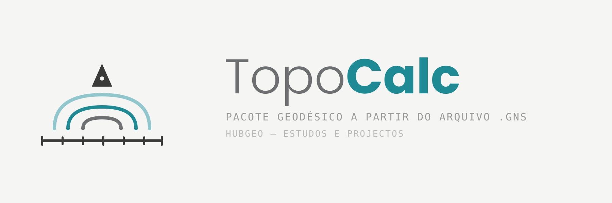

# TopoCalc



Ferramenta em Python (CLI + interface web opcional) para processar arquivos
brutos `.GNS` de receptores GNSS Hi-Target/Champion e gerar automaticamente
um pacote de entregáveis geodésicos: relatório `.docx`/`.pdf`, `.kml` e
planilha `.xlsx` — todos com o logo do TopoCalc embutido.

## ⚠️ Aviso importante

O formato `.GNS` é **proprietário e não documentado oficialmente** pelo
fabricante. A extração binária usada aqui (offset `0x5A`, latitude/longitude
em radianos como `float64` little-endian, altitude em metros como `float32`
little-endian) foi obtida por **engenharia reversa** e validação manual
cruzada em arquivos dos modelos V90/HITV90 e D8 Pro/HITV200 (firmwares 90.0
e 100.0). Não há garantia de que o layout se mantenha em outros modelos,
firmwares ou versões de formato — trate os resultados como preliminares e
confira com o processamento oficial do fabricante sempre que possível.

Esta ferramenta **não realiza processamento diferencial** (RINEX/baseline).
As coordenadas usadas são as gravadas pelo próprio receptor no arquivo
`.GNS`, sem correção diferencial, e sem informação de altura de antena,
PDOP ou resíduos.

## Instalação

```bash
python -m venv .venv
source .venv/bin/activate
pip install -r requirements.txt
```

Para gerar o PDF, é necessário ter o **LibreOffice** instalado
(`soffice`/`libreoffice` no PATH). Sem ele, use `--skip-pdf`.

## Uso — CLI

```bash
python -m topocalc.cli \
  --input estacao_base.gns ponto_01.gns ponto_02.gns ponto_03.gns \
  --output ./saida_gns
```

Opções:

- `--base NOME_DO_ARQUIVO` — força qual arquivo é a BASE. Se omitido, o app
  detecta automaticamente o arquivo com maior número de sentenças `ZDA`.
- `--skip-pdf` — pula a conversão para PDF (útil sem LibreOffice).
- `--skip-validation` — pula as validações automáticas ao final.

Saída (na pasta `--output`):

- `relatorio_geodesico.docx` e `relatorio_geodesico.pdf` (com o logo do
  TopoCalc na capa)
- `pontos_levantamento.kml`
- `planilha_geodesica.xlsx` (com aba "Capa" trazendo o logo)

## Uso — Interface Web

```bash
python -m topocalc.web_app
```

Abra `http://127.0.0.1:5000` (cabeçalho com o ícone do TopoCalc), envie os
arquivos `.GNS` e baixe o `pacote_geodesico.zip` com os 4 entregáveis.

## Gerar arquivos de amostra (para testar sem hardware real)

```bash
python scripts/make_sample_gns.py ./amostras_gns
python -m topocalc.cli --input ./amostras_gns/*.gns --output ./saida_teste
```

> Os arquivos gerados por `make_sample_gns.py` são **sintéticos**, apenas
> para testar o pipeline ponta a ponta — não são arquivos reais de receptor.

## Validações automáticas

A cada execução (a menos que `--skip-validation`), o app confere:

1. Que os valores numéricos batem entre docx/kml e a planilha xlsx.
2. Que nenhuma tabela do relatório `.docx` ultrapassa a largura útil da
   página.
3. Que a planilha `.xlsx` recalcula sem erros de fórmula (`#REF!`,
   `#VALUE!`, `#DIV/0!`, `#N/A`, `#NAME?`), via recálculo com LibreOffice
   headless.
4. Que o caso de apenas 1 arquivo com sentenças `ZDA` é tratado como
   observação informativa, não como erro.

## Identidade visual

- `assets/topocalc_logo.svg` / `.png` — logo completo (ícone + wordmark).
- `assets/topocalc_icon.svg` / `.png` — ícone isolado, para favicon/avatar.

Paleta: teal `#1E8A93`, teal claro `#8FC7CC`, cinza `#6E6F71`, tinta
`#3A3A39` — na mesma linha de cor da identidade visual da HubGeo.

## Estrutura do projeto

```
topocalc/
  __init__.py
  assets.py           # localização dos arquivos de logo
  parser.py            # leitura binária/ASCII dos arquivos .GNS
  geo_calc.py            # conversões e cálculos geodésicos (pyproj)
  pipeline.py              # orquestra parser + geo_calc num resultado único
  docx_report.py            # relatório Word (com logo na capa)
  pdf_report.py               # conversão docx -> pdf (LibreOffice)
  kml_export.py                 # exportação KML
  xlsx_export.py                  # planilha com fórmulas nativas + aba Capa
  charts.py                        # gráficos matplotlib (croqui + distâncias)
  validate.py                        # validações automáticas
  cli.py                               # interface de linha de comando
  web_app.py                            # interface web (Flask), com o logo
assets/
  topocalc_logo.svg / .png              # logo completo
  topocalc_icon.svg / .png                # ícone isolado
scripts/
  make_sample_gns.py                       # gerador de .GNS sintéticos p/ teste
```
